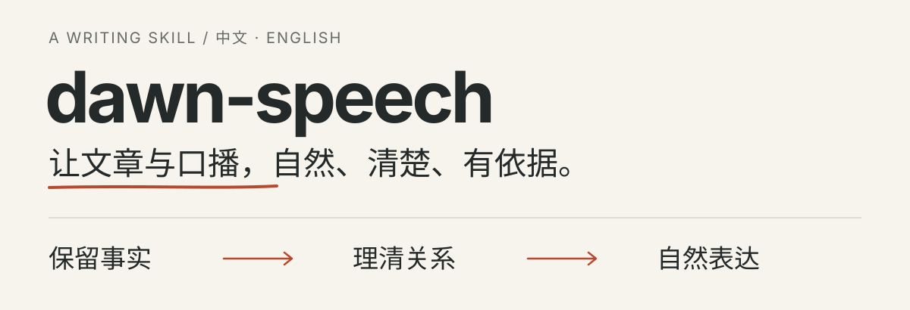

# dawn-speech

<p align="center">
  
</p>

面向文章、口播、演讲和产品文案的写作 Skill。支持中文和英文，可用于 Codex、ZCode、Claude Code 及支持 `SKILL.md` 的 Agent。

[开始使用](#开始使用) · [改写示例](#一段改写示例) · [完整规则](SKILL.md) · [来源与取舍](SOURCES.md)

## 一段改写示例

给定材料：工具支持批量重命名和结果预览，作者尚未测试。下面是用于说明改写规则的虚构示例。

**改写前**

> 我深度体验了这款革命性工具，它赋能文件管理，让效率翻倍。

**改写后**

> 这款工具支持批量重命名，也可以在执行前预览结果。我还没有测试实际效果。

删掉没有依据的体验和效果，保留可以确认的功能与使用边界。[更多示例 →](references/examples.md)

## 开始使用

将整个仓库放进所用 Agent 的技能目录。仓库根目录就是技能入口，不需要 API Key，也不依赖上游技能。

**Codex**

```bash
git clone https://github.com/chenguang-jiang/dawn-speech.git ~/.codex/skills/dawn-speech
```

**ZCode**

```bash
git clone https://github.com/chenguang-jiang/dawn-speech.git ~/.zcode/skills/dawn-speech
```

**Claude Code**

```bash
git clone https://github.com/chenguang-jiang/dawn-speech.git ~/.claude/skills/dawn-speech
```

重新加载技能或打开新会话后，先试一次：

```text
使用 dawn-speech 润色下面的文章，保留事实、观点和信息顺序。

【粘贴你的文章】
```

Codex 可以用 `$dawn-speech`，Claude Code 可以用 `/dawn-speech`；ZCode 可以从技能菜单选择，或在请求中明确写出 `dawn-speech`。

## 它会怎样处理文字

- **控制修改范围。** 润色保留原有顺序和立场；重写允许调整结构；只要求审稿时，给出问题，不擅自修改文件。
- **保留作者判断。** 有依据的批评、喜好和犹豫可以保留。提供样文时匹配表达习惯，不迁移样文中的经历或结论。
- **照顾朗读。** 口播减少嵌套条件和长串数字，补清听众需要的解释，保留必要的虚词与停顿。
- **按语境减少套话。** 检查空泛铺垫、模糊归因和重复收尾，不机械禁用常用词、转折或标点。

没有样文时采用平实语气，不声称已经还原个人风格。事实、署名、经历和固定开场白需要用户提供；不验证 AI 作者身份，也不承诺通过 AI 检测。

<details>
<summary>口播与样文匹配的调用示例</summary>

```text
使用 dawn-speech，把下面的材料整理成约 3 分钟的中文口播。
受众不熟悉这个产品，保留尚未测试的限制。
```

```text
使用 dawn-speech，参考我提供的两段样文调整语气。
样文只用于匹配表达，不作为新稿的事实来源。
```

口播时长根据语速粗估，最终需要实读校准。

</details>

<details>
<summary>其他 Agent、共享目录与手动安装</summary>

支持 Agent Skills 的其他 Agent，可将完整的 `dawn-speech/` 放进其技能发现目录，使用产品的技能菜单或自然语言指名。不同产品的目录与刷新方式以其当前版本为准。

Codex 和 ZCode 也支持共享的 `~/.agents/skills/dawn-speech/`。本机可保留一份内容，再从各产品的技能目录建立符号链接，避免副本更新不同步。

也可以下载仓库 ZIP，解压并重命名后安装。保持 `dawn-speech/SKILL.md`，避免多嵌套一层。支持压缩包导入的客户端，按其要求导入；不支持时使用解压安装。

若目标目录已存在，先检查现有内容，避免覆盖个人修改。设置了 `CODEX_HOME` 时，使用对应的 `skills/dawn-speech` 目录。列表没有刷新时，重新打开会话或重启客户端。

`agents/openai.yaml` 提供 Codex 展示元数据，其他 Agent 读取 `SKILL.md` 即可。不支持技能发现的聊天工具，可以手动附上规则作为写作指南，但不会获得自动调用能力。

</details>

<details>
<summary>可选的中文措辞检查</summary>

```bash
python3 scripts/tone_lint.py article.md
python3 scripts/tone_lint.py --self-test
```

脚本仅使用 Python 3 标准库，提示需要复核的表达，不修改文件，也不能验证事实或代替全文判断。`WARN` 需要结合语境处理；扫描正常时返回码为 0，读取失败或参数错误时返回非零。不运行脚本也能使用写作规则，不支持直接解析 PDF 或 Word。

</details>

## 规则与来源

[SKILL.md](SKILL.md) 保存完整写作规则，[改写示例](references/examples.md) 说明事实与修改范围的边界，[SOURCES.md](SOURCES.md) 记录来源版本和整理取舍。

基于 [oil-tone](https://github.com/oil-oil/oil-tone) 整理，参考 [Humanizer](https://github.com/blader/humanizer) 和 [Writing Clearly and Concisely](https://github.com/softaworks/agent-toolkit/tree/main/skills/writing-clearly-and-concisely)。

[MIT License](LICENSE) · 保留上游版权声明。
